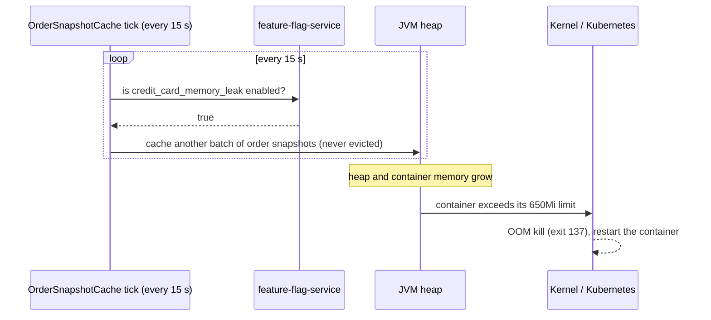

# CreditCardMemoryLeak

| | |
|---|---|
| Flag ID | `credit_card_memory_leak` |
| Default | off (`ENABLE_CREDIT_CARD_MEMORY_LEAK`) |
| Blast radius | The `credit-card-order-service` container |
| Time to visible effect | Memory growth within a minute; first OOM kill after about an hour at the default rate |

## What the user sees

Nothing at first. Requests keep working while the memory of `credit-card-order-service`
climbs in a straight line. When the container reaches its memory limit, the kernel
kills it: Kubernetes reports the container as `OOMKilled` (exit code 137), raises its
restart count, and starts it again. While it restarts, the Credit Card tab fails.

Because the flag stays on, the leak starts again after every restart. The memory chart
shows a sawtooth and the restart count keeps rising until the flag is turned off.

This pattern produces a **memory leak and out-of-memory kills** rather than an
exception or a slowdown. The JVM never throws `OutOfMemoryError` and no error is logged
before the kill, so logs and traces alone don't point at the cause.

## Flow



## How it is implemented

`OrderSnapshotCache` runs a background tick every 15 seconds on its own thread. While
the flag is on, each tick calls `cacheOrderSnapshots`, which adds 64 KB order snapshots
to a `static` list that nothing evicts:

```java
if (openFeatureAPI.getClient().getBooleanValue(FLAG_ID, false)) {
    cacheOrderSnapshots();
} else if (!SNAPSHOTS.isEmpty()) {
    SNAPSHOTS.clear();
}
```

The leak runs whether or not there is traffic, so its rate is predictable.

The kill comes from the kernel and not the JVM because the service runs with a heap
ceiling above its container memory limit (`-Xmx1g` against a 650Mi limit, set in
`JAVA_TOOL_OPTIONS`). The heap never fills up, so the JVM never throws
`OutOfMemoryError`. The container's memory use crosses the limit first. Without that
gap the JVM would fail on its own, and Kubernetes would never report an OOM kill.

| Setting | Where | Default | Effect |
|---|---|---|---|
| `MEMORY_LEAK_MB_PER_MINUTE` | `credit-card-order-service` env | `8` | How fast the heap grows while the flag is on. The default gives about one OOM kill an hour; 120 gets there in about 4 minutes |
| `-Xmx1g` in `JAVA_TOOL_OPTIONS` | `credit-card-order-service` env | set | Keeps the JVM heap ceiling above the memory limit, so the container is OOM-killed |
| `resources.limits.memory` | Helm values | `650Mi` | The memory limit the leak runs into |

`compose.dev.yaml` sets the same heap ceiling and a `650m` memory limit, so the pattern
also ends in an OOM kill locally (`docker inspect` shows `"OOMKilled": true`).

## Turning it off

Turning the flag off makes the next tick drop every cached snapshot, so the memory is
freed without a restart.

## Scope

Only `credit-card-order-service` is affected. Other services keep working, except for
whatever calls credit-card-order-service while its container is restarting.

## Source

- `src/credit-card-order-service/src/main/java/com/dynatrace/easytrade/creditcardorderservice/OrderSnapshotCache.java`
- `helm/easytrade/values.yaml` (`credit-card-order-service.env`)
