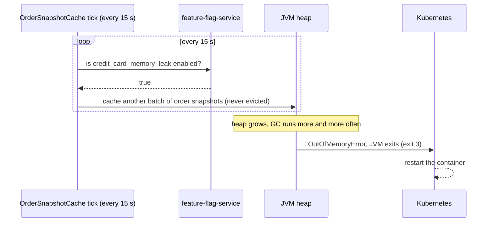

# CreditCardMemoryLeak

| | |
|---|---|
| Flag ID | `credit_card_memory_leak` |
| Default | off (`ENABLE_CREDIT_CARD_MEMORY_LEAK`) |
| Blast radius | The `credit-card-order-service` container |
| Time to visible effect | Heap growth within a minute; first out-of-memory restart after about an hour at the default rate |

## What the user sees

Nothing at first. Requests keep working while the heap of `credit-card-order-service`
climbs in a straight line. As the heap fills, garbage collection runs more and more
often. When there is no room left, the JVM throws `OutOfMemoryError: Java heap space`
and exits, and Kubernetes restarts the container (reason `Error`, exit code 3). While
it restarts, the Credit Card tab fails.

Because the flag stays on, the leak starts again after every restart. The heap chart
shows a sawtooth and the restart count keeps rising until the flag is turned off.

This pattern produces a **memory leak and out-of-memory restarts** rather than an
exception or a slowdown. The log names the error, not the code that holds the memory,
so finding the cause takes memory profiling.

## Flow



## How it is implemented

`OrderSnapshotCache` runs a background tick every 15 seconds on its own thread. While
the flag is on, each tick calls `cacheOrderSnapshots`, which adds 64 KB order snapshots
to a `static` list that nothing evicts:

```java
if (openFeatureAPI.getClient().getBooleanValue(FLAG_ID, false)) {
    cacheOrderSnapshots();
} else if (!SNAPSHOTS.isEmpty()) {
    SNAPSHOTS.clear();
}
```

The leak runs whether or not there is traffic, so its rate is predictable.

While the flag is on, a second task runs every second on the same thread and calls
`recalculateOrderTotals`, which fills scratch buffers and drops them right away. This
is the service's normal working garbage, not part of the leak: it keeps the young
generation filling up, so the JVM collects garbage several times a minute, as it would
in a busy service. Without it the pod is idle apart from the leak, and GC runs less
than once a minute. Memory profilers that judge objects by how many collections they
survive then have nothing to tell the leak from short-lived data. With the churn on,
the cached snapshots survive every collection while the scratch buffers survive none.

The service runs with a heap sized to half its container memory limit
(`-XX:MaxRAMPercentage=50`, set in `JAVA_TOOL_OPTIONS`), which leaves room for
non-heap memory. With `-XX:+ExitOnOutOfMemoryError` the JVM exits when the heap is full
instead of carrying on in a broken state, so Kubernetes restarts it.

| Setting | Where | Default | Effect |
|---|---|---|---|
| `MEMORY_LEAK_MB_PER_MINUTE` | `credit-card-order-service` env | `5` | How fast the heap grows while the flag is on. The default runs out of heap about once an hour; 120 gets there in about 3 minutes |
| `MEMORY_LEAK_CHURN_MB_PER_MINUTE` | `credit-card-order-service` env | `600` | Short-lived garbage allocated while the flag is on. With the default heap it gives 7 or more collections a minute through the whole cycle (more while the heap is still small) and doesn't change the restart interval; `0` turns it off |
| `-XX:MaxRAMPercentage=50` in `JAVA_TOOL_OPTIONS` | `credit-card-order-service` env | set | Caps the heap at half the memory limit |
| `-XX:+ExitOnOutOfMemoryError` in `JAVA_TOOL_OPTIONS` | `credit-card-order-service` env | set | Exits on `OutOfMemoryError`, so Kubernetes restarts the service |
| `resources.limits.memory` | Helm values | `650Mi` | The memory limit the heap size is derived from |

`compose.dev.yaml` sets the same JVM options and a `650m` memory limit, so the pattern
behaves the same locally.

### Why the JVM runs out of memory, not the container

A Java heap leak in a correctly sized container ends this way: the heap fills, GC works
harder and harder, and the JVM fails with `OutOfMemoryError`. A Kubernetes `OOMKilled`
(exit 137) usually means the process grew *outside* the heap (native memory, threads),
or that the heap was sized above the container limit. Forcing an OOM kill here would
need exactly that misconfiguration.

## Turning it off

Turning the flag off makes the next tick drop every cached snapshot, so the memory is
freed without a restart.

## Scope

Only `credit-card-order-service` is affected. Other services keep working, except for
whatever calls credit-card-order-service while its container is restarting.

## Source

- `src/credit-card-order-service/src/main/java/com/dynatrace/easytrade/creditcardorderservice/OrderSnapshotCache.java`
- `helm/easytrade/values.yaml` (`credit-card-order-service.env`)
